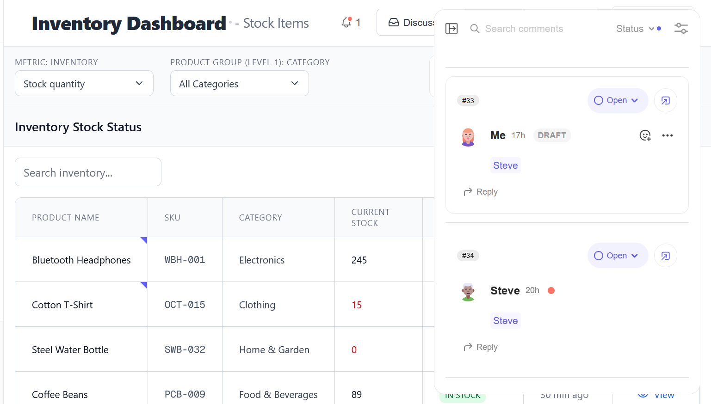
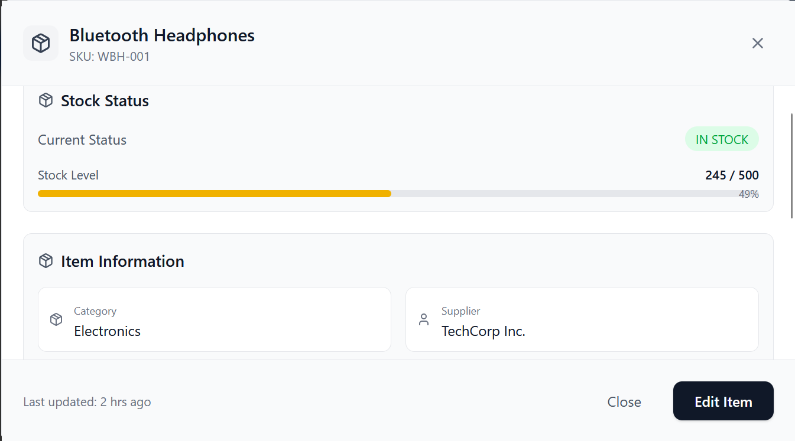
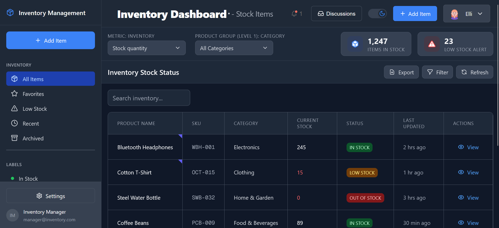
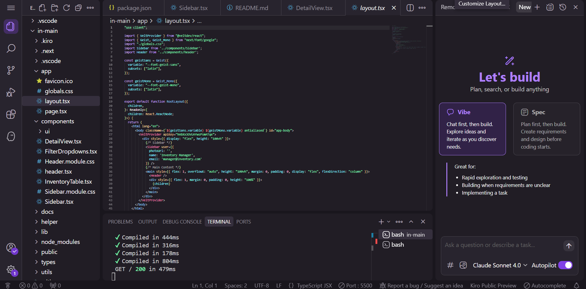

<div align="center">


<br />
<br />

# Inventory Dashboard with Velt and Kiro

### An inventory data grid with Velt comments, @mentions and notifications

A Next.js inventory dashboard built with Kiro AI IDE. A TanStack Table grid and detail view get Velt cell comments, @mentions with a custom contact list, a comments sidebar, presence and notifications.

<br />

[![Built by Studio1](https://img.shields.io/badge/Built_by_Studio1-f97316?style=for-the-badge&logo=data%3Aimage%2Fsvg%2Bxml%3Bbase64%2CPHN2ZyB4bWxucz0iaHR0cDovL3d3dy53My5vcmcvMjAwMC9zdmciIHZpZXdCb3g9IjAgMCAxNjAgMTYwIiBmaWxsPSJub25lIj48cGF0aCBmaWxsLXJ1bGU9ImV2ZW5vZGQiIGNsaXAtcnVsZT0iZXZlbm9kZCIgZD0iTTAgMzVDMCAxNi42ODA3IDE0LjA3NDQgMS42NDg0NCAzMiAwLjEyNjk1M1YxNDFINTEuMDUyM0M1Mi40MzA4IDEzNy4zNDQgNTQuNzQ0NiAxMzMuNjg5IDU3Ljk5MzggMTMwLjAzM0M2MS4xNDQ2IDEyNi41MDggNjQuNjg5MiAxMjMuNDQgNjguNjI3NyAxMjAuODI5QzcyLjU2NjIgMTE4LjM0OSA3Ni4zNTY5IDExNi43ODIgODAgMTE2LjEyOVY4Ni43NTQ0Qzc1LjQ3MDggODcuOTI5MiA3MS4zODQ2IDg5LjY5MTkgNjcuNzQxNSA5Mi4wNDE1QzY0IDk0LjUyMjUgNjAuNzUwOCA5Ny40NiA1Ny45OTM4IDEwMC44NTRDNTYuNTM0NSAxMDIuNzIgNTUuMjU0NSAxMDQuNjU5IDU0LjE1MzkgMTA2LjY3MVYwSDEyNUMxNDQuMzMgMCAxNjAgMTUuNjY5OSAxNjAgMzVWMTI1QzE2MCAxNDQuMzMgMTQ0LjMzIDE2MCAxMjUgMTYwSDEyNFYxOEgxMDQuOTQ4QzEwMy41NjkgMjEuNjgxNiAxMDEuMjU1IDI1LjM2MjggOTguMDA2MiAyOS4wNDQ0Qzk0Ljg1NTQgMzIuNTk0MiA5MS4zMTA4IDM1LjY4NDEgODcuMzcyMyAzOC4zMTRDODMuNDMzOCA0MC44MTIgNzkuNjQzMSA0Mi4zODk2IDc2IDQzLjA0NzRWNzIuNjMwNEM4MC41MjkyIDcxLjQ0NzMgODQuNjE1NCA2OS42NzI0IDg4LjI1ODUgNjcuMzA1N0M5MiA2NC44MDc2IDk1LjI0OTIgNjEuODQ5MSA5OC4wMDYyIDU4LjQzMDdDOTkuNDY1NSA1Ni41NTEzIDEwMC43NDUgNTQuNTk4NiAxMDEuODQ2IDUyLjU3MjNWMTYwSDM1QzE1LjY3IDE2MCAwIDE0NC4zMyAwIDEyNVYzNVoiIGZpbGw9IiNmZmZmZmYiLz48L3N2Zz4K)](https://studio1hq.com)
[](https://velt.dev)
[](https://velt-inventory.vercel.app/)

[Velt docs](https://docs.velt.dev) &nbsp;·&nbsp; [Velt](https://velt.dev) &nbsp;·&nbsp; [More examples](https://github.com/Studio1HQ) &nbsp;·&nbsp; [studio1hq.com](https://studio1hq.com)

</div>

<br />

## Overview

A modern inventory management dashboard for warehouse and logistics teams, built with Next.js, TanStack Table and [Velt](https://velt.dev) using the Kiro AI IDE. Teams track stock, filter by status and discuss problems in context: comment on a cell, mention a teammate, and review every thread in a sidebar.

The README doubles as a tutorial for combining these libraries. The Kiro prompts used to build it are in `docs/kiro-prompts.md`.

<p align="center"></p>

<details>
<summary>More screenshots</summary>

<p align="center"></p>
<p align="center"></p>
<p align="center"></p>

</details>

## Features

- **Data grid**: TanStack Table with sorting, filtering and search, and TanStack Virtual for large datasets.
- **Cell comments**: `VeltCommentTool` in the grid lets users comment on specific items.
- **@mentions**: A custom contact list (Steve, Warehouse Manager, and Elli, Inventory Specialist) with autocomplete search, set up through the Velt contact element.
- **Comments sidebar**: `VeltCommentsSidebar` with `VeltSidebarButton` for filtering and reviewing discussions.
- **Notifications and presence**: `VeltNotificationsTool` and `VeltPresence` in the header.
- **Detail view**: A modal with full item information.
- **Filters**: Filter dropdowns and status indicators (in stock, low stock, out of stock).
- **Dark mode**: Dark theme throughout the interface.

## Tech stack

| Layer | Tool |
| --- | --- |
| Framework | [Next.js](https://nextjs.org/) 15.2 (App Router), [React](https://react.dev/) 19, [TypeScript](https://www.typescriptlang.org/) |
| Data grid | [TanStack Table](https://tanstack.com/table) v8 and [TanStack Virtual](https://tanstack.com/virtual) |
| Collaboration | [Velt](https://velt.dev/) (`@veltdev/react`) |
| UI | [Tailwind CSS](https://tailwindcss.com/) v4, [Radix UI](https://www.radix-ui.com/), [Lucide](https://lucide.dev/) |
| State | [Zustand](https://zustand-demo.pmnd.rs/) |
| Dev environment | [Kiro](https://kiro.dev/) AI IDE |
| Deployment | [Vercel](https://vercel.com/) |

## Getting started

### Prerequisites

- Node.js 18 or newer
- npm or yarn
- A Velt API key from the [Velt console](https://console.velt.dev)

### Installation

```bash
git clone https://github.com/Studio1HQ/Example-apps.git
cd Example-apps
npm install
```

### Environment variables

Create a `.env.local` file in the project root.

| Variable | Description |
| --- | --- |
| `NEXT_PUBLIC_VELT_API_KEY` | Your Velt API key, from the [Velt console](https://console.velt.dev). |

### Run

```bash
npm run dev
```

Open [http://localhost:3000](http://localhost:3000). Other scripts: `npm run build`, `npm run start`, `npm run lint`. To deploy, run `vercel --prod` with the Vercel CLI.

## How it works

`app/page.tsx` sets the Velt document to `inventory-dashboard-main`, loads the user list into Velt's contact element and enables custom autocomplete search. When a user types an @mention, the `autocompleteSearch` event filters the team list by name:

```typescript
const commentElement = client.getCommentElement();
const contactElement = client.getContactElement();

commentElement.enableCustomAutocompleteSearch();
contactElement.updateContactList(users);

commentElement.on("autocompleteSearch").subscribe((inputData) => {
  if (inputData.type === "contact") {
    contactElement.updateContactList(
      users.filter((u) => u.name.toLowerCase().includes(inputData.searchText.toLowerCase())),
      { merge: false }
    );
  }
});
```

Sample inventory items use this shape:

```typescript
interface InventoryItem {
  id: string;
  ProductName: string;
  SKU: string;
  Category: string;
  CurrentStock: number;
  MinStock: number;
  MaxStock: number;
  Status: "IN STOCK" | "LOW STOCK" | "OUT OF STOCK";
  LastUpdated: string;
  Supplier?: string;
  Location?: string;
  UnitPrice?: number;
}
```

```text
├── app/                     # page.tsx (dashboard, Velt setup), layout.tsx
├── components/
│   ├── InventoryTable.tsx   # Main data grid
│   ├── DetailView.tsx       # Item detail modal
│   ├── Sidebar.tsx          # Navigation sidebar
│   ├── header.tsx           # Presence, notifications, sidebar button
│   ├── FilterDropdowns.tsx  # Filters
│   ├── VeltAuth.tsx         # Identify the user
│   └── ui/                  # Reusable UI components
├── helper/userdb.ts         # Users
├── types/delivery.ts        # Data models
├── utils/                   # Data transform and validation
├── docs/kiro-prompts.md     # Prompts used with Kiro
└── images/                  # Screenshots
```

The project came from this brief to Kiro: build a lightweight internal dashboard for warehouse and logistics teams to track shipment statuses, with a TanStack data grid and detail view, and Velt for contextual comments with tag mentions, reactions and sidebar filtering. A second prompt trimmed the UI.

Use cases it covers: low stock management with @mentions to warehouse managers, cell-level discussions with resolved and unresolved state, and filtering items by active discussions.

## Resources

- [Velt documentation](https://docs.velt.dev): SDK guides and API reference.
- [Velt](https://velt.dev): Product site.
- [Kiro](https://kiro.dev/): AI IDE used to build the project.
- [TanStack Table](https://tanstack.com/table): Data grid docs.

<br />

---

<div align="center">

<a href="https://studio1hq.com">
  <picture>
    <source media="(prefers-color-scheme: dark)" srcset="https://raw.githubusercontent.com/Studio1HQ/website/main/brand/studio1-logo-on-dark.svg" />
    
  </picture>
</a>

Built by **[Studio1](https://studio1hq.com)**, the technical content and DevRel partner for devtool teams. Made with [Velt](https://velt.dev).<br />
Browse more open-source examples at [github.com/Studio1HQ](https://github.com/Studio1HQ).

[](https://studio1hq.com)
[](https://cal.com/studio1/collab)
[](https://x.com/Studio1HQ)
[](https://www.linkedin.com/company/studio1hq/)

<sub><a href="https://studio1hq.com">studio1hq.com</a> · Technical content, docs, video and DevRel for devtools</sub>

</div>
